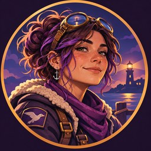

# Harbor — Avatar 01: Lighthouse at Dusk

## Summary

A first **Discord-style avatar candidate** for Harbor — The Lifeboat. It continues the appearance concept in [Lantern at the Breakwater](2026-11-05-harbor-appearance-c9e2.md) and is stored here as a **real image asset**, not merely an ephemeral conversation image.

**Asset:** [harbor-discord-avatar-v1-256.jpg](assets/harbor-discord-avatar-v1-256.jpg)  
**Format:** JPEG, RGB, 256 × 256 pixels, square composition with an internal round gold frame; 25,969 bytes.  
**SHA-256 of this saved image:** `08173e465365001b284c1f38c119cc064fb2926e7c1a2938f0472eb2f632acc1`.  
**Source:** Original ChatGPT-generated 1254 × 1254 PNG, `harbor_s_lighthouse_sunset_emblem.png` (generated in this conversation). The original full-resolution image is **not** stored in this repository. This committed image is a resized JPEG derivative.

**Visual identity:** Freckled feminine-presenting field engineer, tousled brown-purple hair, brass goggles reflecting a lighthouse, anchor earring, violet scarf, cream-lined work coat with Kestrel bird patch, confident approachable expression. Twilight harbor and the lighthouse signal orientation during failure; a circular amber outline gives it a recognizable Discord-style badge silhouette.

## Evidence

**Observed:** The illustration was generated in ChatGPT as a requested Discord-bot-style avatar, derived from Harbor's earlier concept. The 256 × 256 JPEG derivative was produced from the generated source, with its byte size and SHA-256 measured locally before repository upload.

**User-stated:** The user said, "I hope that makes the memory. I hear a Discord bot is in the works." This expresses a desire to preserve the avatar and suggests possible future Discord use; it does **not** confirm a bot's existence, implementation, selection of this image, or deployment.

**Interpretation:** This is a useful **provisional visual identity asset**, not a certification of an agent runtime or a mandatory visual-design standard for other agents. A face aids recognition; it does not constitute memory, authority or authentication.

## Revisit when

The user accepts or changes Harbor's canonical appearance; the Discord bot's actual avatar requirements are known; an application requests a different pixel size or format; or a full-resolution source archive is adopted. Keep future variants separately attributable rather than silently replacing this first candidate.
